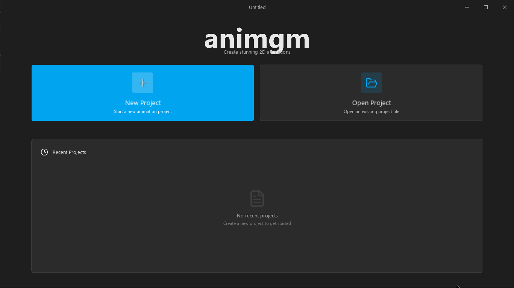
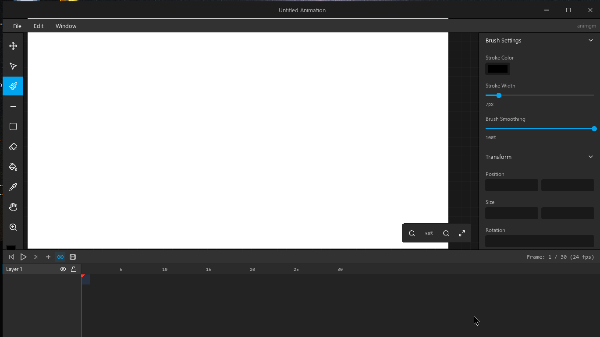
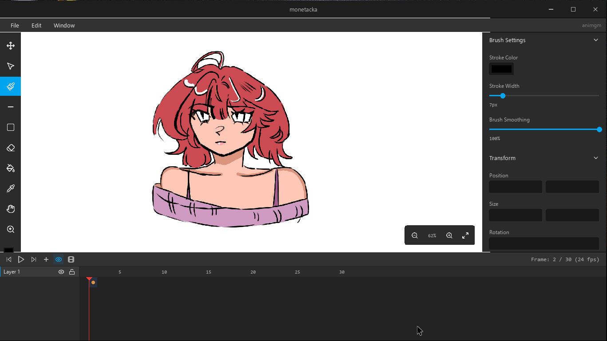

# animgm

A 2D frame-by-frame animation program built in **GameMaker**

## Screenshots

| Project Manager | Canvas | Drawing |
| --- | --- | --- |
|  |  |  |

## Features

- **Project Manager** - welcome screen with recent projects, thumbnails, and a
  New Project dialog with resolution/format presets (1080p, 4K, Square, Story…).
- **Drawing tools** - brush (with a Photoshop-style stroke stabilizer and
  anti-aliased edges), line, shapes (rect/ellipse/polygon/star…), eraser,
  paint bucket (flood fill), eyedropper, hand, zoom.
- **Selection & transform** - rectangular marquee with move / resize / rotate
  handles, plus editable X/Y/W/H/Rotation fields in the properties panel.
  Cut / Copy / Paste / Delete.
- **Timeline** - layers, keyframes (Flash-style spans), playback, onion skin,
  scrubbing, adjustable frame count and FPS.
- **Layers** — add / duplicate / reorder / rename / delete (right-click menu),
  visibility, lock, per-layer opacity.
- **Custom window chrome** - borderless window with a custom title bar
  (minimize / maximize / close), smooth maximize animation, and an
  unsaved-changes guard on close / open / new.
- **Image import** - via File → Import or (WIP) drag-and-drop; each image lands
  on its own new layer.
- **Save / Load** - compact binary `.anst` format (deflate-compressed raster
  frames, cropped to their bounding box).
- **MP4 export**
- **Audio track** — import a `.wav`, `.ogg`, or `.mp3,
  drag it along the timeline to reposition/trim it, played back in sync
  while scrubbing/playing in the editor..
## Coming soon. At best at the end of October 
- **Skeletal animation** -  a real bone hierarchy with its own
  animation curves, not a one-shot bake:
  - Bones are built from a selection, from a whole layer's artwork
    ("Use as Bone"), or as empty bones to use as a root/hip.
  - Each bone has a full local transform (translate / rotate / scale) relative
    to its parent, a shaft with grabbable pivot and tip handles, its own draw
    order and a visibility toggle.
- **Mesh deformation.** - Right-click a bone → *Add Mesh* lays a grid over its
    artwork and auto-weights every vertex to the nearest bones (up to four
    each, inverse-square falloff). The artwork then bends across the chain via
    linear blend skinning instead of snapping at the joints; the selected bone
    shows its deformed wireframe. *Rebind Weights* re-derives the weights after
    the rest pose changes.

## File format (`.anst`)

Binary. Header then project metadata, layers, and
per-keyframe raster blobs. Frames are stored as the deflate-compressed ARGB

## Planned

- **Text**
- **Vector Graphics** - Working with vector graphics, importing SVG, and various tools for working with vector graphics
